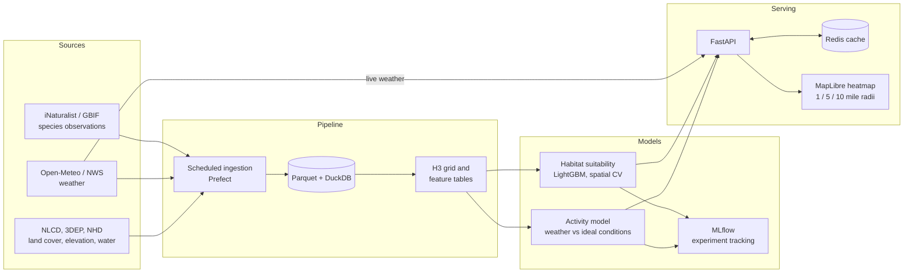

# Architecture (v1)

## Score

Likelihood = P(suitable habitat) x P(active | current conditions)

## Notes
- Habitat scores are precomputed; only the weather layer refreshes hourly.
- Training uses a wider region than Heflin; predictions are served locally.
